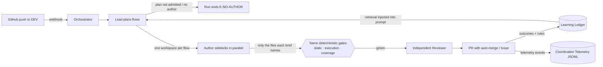

# QAyaba
<div align="center">

[](https://nodejs.org)
[](https://www.typescriptlang.org)
[](https://playwright.dev)
[](https://www.docker.com)
[](https://opencode.ai)

</div>

## Contents

- [1. Overview](#1-overview)
- [2. How it works](#2-how-it-works)
  - [Architecture](#architecture)
  - [The QA pipeline](#the-qa-pipeline)
  - [Multi-agent coordination](#multi-agent-coordination)
  - [What happens at the end](#what-happens-at-the-end)
  - [The learning layer](#the-learning-layer)
- [3. Getting started](#3-getting-started)
  - [Prerequisites](#prerequisites)
  - [Install and verify](#install-and-verify)
  - [Configure your API key](#configure-your-api-key)
  - [AI model configuration](#ai-model-configuration)
  - [Onboard an app](#onboard-an-app)
  - [Trigger a manual run](#trigger-a-manual-run)
  - [Deploy with Docker](#deploy-with-docker)

---

**Autonomous QA that watches your repos, tests every deploy, and learns from every failure.**

When a commit lands on DEV, an AI agent reads the change, writes Playwright tests for what could break, runs them against the live environment, and either opens a PR against the app's repository with the new tests or files a GitHub Issue if something fails.

It is app-agnostic: onboard any repo by adding a single YAML file. No app code lives here.

---

## 1. Overview

qayaba turns every deploy into a QA checkpoint, automatically.

| Capability | What it means |
|---|---|
| **Commit-aware testing** | Reads the diff and commit message to understand what changed. Skips style-only commits, writes targeted tests for features and fixes, runs regression-only for refactors. |
| **Multi-agent coordination** | A read-only lead agent plans the change's independent flows while bounded author sidekicks write them in parallel, each in a workspace of its own and each closing its own run loop — all subject to the same quality gates. |
| **Provider-agnostic runtime** | Runs on OpenCode through one facade. Every role's model is configured in `agents/opencode.json`; the primary, reviewer, and chat assignments can be overridden from the Dashboard or the environment. |
| **Independent review** | A separate reviewer agent judges every generated test for value. Tests that click without asserting, use fragile selectors, or miss the actual change are rejected before they reach the suite. |
| **Self-improving suite** | When tests pass and the reviewer approves, they are committed to the app's repository via PR with auto-merge. The suite grows with every deploy and never degrades into "green noise." |
| **Learning from failures** | Every failed run is reflected on, distilled into a reusable rule, and injected into future runs. Mutation testing measures whether the tests actually catch bugs (valueScore). Rules that correlate with better outcomes are promoted; the rest decay. |
| **Multi-app, single engine** | One centralized service watches all your team's repos. Each app gets its own namespace for test data and persistent memory. |
| **Shadow mode** | Onboard a repo without touching it: the full pipeline runs, but PRs and Issues are only logged. Flip the switch when you are ready. |

<details>
<summary>What it is not</summary>

- It does **not** build or start your app. Tests run against the live DEV URL.
- It does **not** replace your existing test suite. It augments it with AI-generated E2E coverage.
- It does **not** require per-app code changes. Onboarding is a YAML config file.

</details>

---

## 2. How it works

### Architecture



<table>
<tr>
<td width="50%" valign="top">

### Orchestrator
**Node.js** deterministic infrastructure.

Receives webhooks, manages the sequential queue, clones repos, runs Playwright against DEV, publishes results. It admits the lead's plan, runs the flows through a bounded pool and takes back only what each brief names. Runs mutation testing to measure test quality (valueScore), maintains the learning ledger, and appends every coordination decision to a durable telemetry ledger. Every side-effecting step is dependency-injected and unit-tested with stubs.

</td>
<td width="50%" valign="top">

### Agent Runtime
**OpenCode** behind one provider-neutral facade; another runtime is added as a strategy behind it.

The lead (`qa-lead`) is read-only: it explores the code with the code-graph tool, may ask read-only explorer sidekicks (`qa-explore`) to check what it needs, and plans the change's flows. A dedicated author sidekick (`qa-author`) writes each flow in a workspace of its own — it may only write the one file its brief names, must report what it actually wrote, and can push the work back when the brief is wrong. The reviewer stays a fully independent judge: neither agent can influence it. The Dashboard's Agent Runtime screen selects role assignments, models, and API keys; `qayaba agent` prints the current configuration.

</td>
</tr>
</table>

Both services share a volume for repo working copies. The AI agent reads code and writes tests directly where the orchestrator expects them.

### The QA pipeline

Every run follows the same sequence, whether triggered by a webhook or manually:

| Step | What happens |
|---|---|
| **1. Deploy gate** | Waits until DEV reports the right commit SHA and is healthy. Skipped if no health endpoint is configured, or in code mode. |
| **2. Classification** | Reads the commit message and diff. Conventional Commits like `style:` with no logic changes are skipped before spending a single token. |
| **3. Retrieval** | Loads learned rules, structural patterns, and proven scenario archetypes from past runs — injects them into the agent prompt. |
| **4. Coordination** | The lead is asked for a plan of independent flows, the orchestrator admits it (or refuses the run with a recorded reason: `E-NO-AUTHOR`), and each flow is handed to an author sidekick. |
| **5. Generation** | One author sidekick per flow, in parallel, reads the blast radius using semantic code navigation and writes tests into the repo; the lead reviews each flow and can send it back to the same sidekick or to a fresh one. |
| **6. Static gate** | TypeScript compilation, ESLint, and Playwright's test list must pass. Invalid code is rejected before execution. |
| **7. Execution** | Runs tests against the live DEV URL (e2e) or the repo's own test runner (code mode). Results are classified as pass, fail, or flaky. Repairs re-run inside the same fix loop, which owns retries, adjudication, and regression checks. |
| **8. Oracle** | For code mode green runs: mutation testing via Stryker measures how many injected bugs the tests actually catch (valueScore). |
| **9. Reflection** | On failed runs, an LLM reflects on the error and produces a preventive rule. The rule is distilled and stored for future runs. |
| **10. Decision** | Green and approved: PR with auto-merge. Failures: GitHub Issue. Flaky: quarantined. DEV down: infrastructure error. Every coordination decision made along the way is appended to the telemetry ledger. |

> [!NOTE]
> **Shadow mode** (`qa.shadow: true` in the app config) runs the full pipeline but does not publish PRs or open Issues. Use this when onboarding a repo for the first time.

### Multi-agent coordination

Every e2e run is coordinated this way; `qa.coordination` only tunes its limits. When a plan is not admitted or no sidekick can author, the run ends `E-NO-AUTHOR` and the reason is recorded. Details: [docs/lead-sidekicks.md](docs/lead-sidekicks.md).

| Piece | Role |
|---|---|
| **Lead plan** | The lead returns a plan of independent flows instead of specs. The plan is untrusted input: the orchestrator keeps only what its shape and the run's limits allow (`maxFlows`, a deterministic spec path per flow) and otherwise refuses the run, with the reason recorded (`E-NO-AUTHOR`). |
| **Author sidekick (bounded executor)** | Authors one flow in a copy of what the run may read, using the harness, fixtures, and selector discipline of the suite; it runs its own spec through `run_spec` until it passes. Only the file its brief names is taken back; any other change is listed as a proposal and never applied. |
| **Fan-out** | A bounded pool (`maxParallel`) with a signal and a time budget per flow. DEV access is serialized per test account by the orchestrator's lease. |
| **Lead review** | The lead reviews each delivered flow and answers `accept`, `revise` (the same sidekick session), `replace` (a fresh sidekick on the escalated model) or `drop`, decided on what the orchestrator saw of the flow's `run_spec` calls, never on the sidekick's word. |
| **Independent reviewer** | Never merged with, influenced by, or executed from the coordinator — whoever wrote the specs, the reviewer judges the same way. |

Every flow's result must be earned: a claimed file the brief did not name is not taken back, and the run's gates (validation, execution, change-coverage, review) are the same for every spec.

**Coordination telemetry** — every delegation, escalation, and final outcome of a coordinated run is appended to `data/coordination-events.jsonl` (one JSON object per line, survives restarts). Inspect it at any time:

```bash
tail -n 5 data/coordination-events.jsonl
```

Optional environment tuning (defaults are production-safe, no configuration required):

| Env var | Default | Purpose |
|---|---|---|
| `COORDINATION_TELEMETRY_PATH` | `data/coordination-events.jsonl` | Durable sink for coordination events (e.g. point to a mounted volume). |
| `COORDINATION_ESCALATED_MODEL` | unset (no escalation model) | Optional stronger model for escalated sidekick sessions; it must be a model of the provider the primary role is assigned to. |

### What happens at the end

| Outcome | Action |
|---|---|
| All green, reviewer approved | PR with auto-merge commits tests into the app's repository |
| All green, reviewer rejected | GitHub Issue for the team to iterate |
| Failures detected | GitHub Issue with sanitized logs |
| Flaky tests | Quarantined, no Issue created |
| DEV unhealthy | Marked as infrastructure error, not a code bug |

### The learning layer

Beyond deciding pass/fail, qayaba learns from every run to improve future ones:

| Component | What it does |
|---|---|
| **Labeler** | Classifies every run into an error class (E-STATIC, E-EXEC-FAIL, E-FALSE-POSITIVE…) — zero LLM, purely from the gates and reviewer. |
| **Oracle** | Measures test quality objectively. For code repos: mutation testing via Stryker — mutates source code, runs the test suite, and scores how many mutants were killed. |
| **Reflector** | On failed runs, an LLM analyzes the error and produces a structured reflection anchored to real artifacts (assert output, uncovered lines, reviewer corrections). |
| **Distiller** | Converts reflections into reusable rules — deduplicated, stored, and injected into future agent prompts so the same mistake isn't made twice. |
| **Curriculum** | Tracks which scenario archetypes (invalid input, re-query-after-mutation, empty state, …) have caught real bugs. Only proven archetypes are fed to the agent. |
| **Attribution** | When a rule was retrieved for a run, the run's valueScore updates the rule's successRate. Rules that correlate with good outcomes are promoted. |

Inspect the learning state at any time:

```bash
npm run qa -- --app my-app --learning
```

Or ask the TUI chat: *"¿qué reglas ha aprendido el sistema?"*

<details>
<summary>Execution modes</summary>

| Mode | When to use |
|---|---|
| `diff` (default) | Webhook-triggered: tests the blast radius of a single commit |
| `complete` | Fill coverage gaps: analyzes the whole repo and tests uncovered flows |
| `exhaustive` | Full audit: re-evaluates every existing test and regenerates the suite |
| `manual` | Focused: generation guided by a natural language prompt |
| `code` target | Source-code testing: runs the repo's own test suite, with mutation testing via Stryker (no browser, no DEV URL) |

</details>

<details>
<summary>Quality gates</summary>

Four layers prevent low-quality tests from entering the suite:

| Layer | What it catches |
|---|---|
| **Static analysis** | Tests that do not compile, violate lint rules, or have missing metadata |
| **AI reviewer** | Tests with trivial assertions, fragile selectors, or no real verification of the change |
| **Change-coverage** | Tests that pass but don't exercise the lines the commit changed — a green suite that proves nothing |
| **Mutation testing** | Tests that pass but don't detect injected bugs — the deepest false positive |

</details>

---

## 3. Getting started

### Prerequisites

- **Node.js 24** or later
- **Docker** and Docker Compose (for production deployment)
- An **OpenCode API key**.
- A GitHub repo you want to watch, deployed to a DEV environment

### Install and verify

```bash
git clone <this-repo>
cd qayaba
npm install
npm test           # unit tests (network and AI calls are stubbed)
npm run typecheck  # strict TypeScript validation
```

### Configure your API key

```bash
cp .env.example .env
```

Edit `.env` and set the provider key:

```
OPENCODE_API_KEY=opencode-go-your-key-here
```

> [!IMPORTANT]
> For production, you also need `GITHUB_TOKEN` and `WEBHOOK_SECRET`.

Every environment variable the service reads, with its type and default, is listed in [docs/settings.md](docs/settings.md) (generated from `src/settings/registry.ts`).

### AI model configuration

The project uses provider-neutral role assignments. The roster, each role's model and its step limit live in `agents/opencode.json`; no model is named anywhere else. Override the three operator-facing assignments from the Dashboard's **Agent Runtime** view or with the `AGENT_*_MODEL` environment variables.

| Role | Agent | Purpose |
|---|---|---|
| `primary` | `qa-lead`, `qa-author`, `qa-explore`, `qa-maintainer`, `qa-proposer` | The lead plans and reviews flows (read-only); the author sidekick writes the Playwright tests; the explorer answers the lead's questions (read-only) |
| `reviewer` | `qa-reviewer` | Read-only quality judge; rejects tests with trivial assertions or fragile patterns |
| `chat` | `qa-assistant`, `qa-reflector` | Read-only operator assistant and the failure reflector |

The prompts are budgeted against the context-window catalog in `qa-engine/src/contexts/generation/infrastructure/prompt-builders/model-window-catalog.ts`. Check `opencode models` when a model in the roster retires.

Assign a stronger model to escalated sidekick sessions via `COORDINATION_ESCALATED_MODEL` when you want a replaced flow to run on a different capacity.

> [!TIP]
> `qayaba agent` prints the current runtime config; `qayaba agent models [provider]` lists a provider's models.

**What you must configure manually:**

| Item | Where | Required |
|---|---|---|
| Provider key | `.env` as `OPENCODE_API_KEY` | The key of the one runtime |
| Model IDs | `agents/opencode.json`, Dashboard Agent Runtime, or `AGENT_PRIMARY_MODEL`/`AGENT_REVIEWER_MODEL`/`AGENT_CHAT_MODEL` | Only if the defaults are unavailable |
| GitHub token | `.env` as `GITHUB_TOKEN` | Yes, for PR and Issue creation |
| Webhook secret | `.env` as `WEBHOOK_SECRET` | Yes, for production webhook validation |

<details>
<summary>What is pre-configured automatically</summary>

| Item | Where | Notes |
|---|---|---|
| Role prompts and procedures | `agents/agent/*.md` | One prompt per role, with the shared rules in `agents/AGENTS.md` |
| Playwright authoring skills | `agents/skill/playwright-authoring/` | Login, geolocation, mobile, uploads |
| Quality review criteria | `agents/skill/test-value-review/` | False-positive pattern catalog |
| MCP servers (Serena, Playwright) | `agents/opencode.json` and agent container | Code navigation + live DEV exploration |
| Multi-agent coordination | `qa.coordination` in the app YAML (limits only) | Every e2e run: the lead plans, author sidekicks (`qa-author`) author the flows; durable telemetry at `data/coordination-events.jsonl`, per-flow time budgets. |
| Docker images | `Dockerfile`, `agents/Dockerfile` | Both services build from these |
| Control-plane API token | `data/.api_token` (auto-generated on first boot; in the container, `/app/data/.api_token` in the `qayaba-data` volume, never in the host's `config/`, which the sandboxed agent code must not reach) | The machine credential — protects the API (`Bearer` auth on every non-public route). On the same machine the `qayaba` console auto-loads it from `$QA_API_TOKEN`, or from this file when the service runs on the host; people sign in with GitHub instead (see below). Set `QA_API_TOKEN` to pin your own. |

</details>

### Signing in to the console

The `qayaba` console reaches the orchestrator over its HTTP control plane, which is `Bearer`-authenticated. There are two ways to authenticate, for two different callers:

- **People → "Log in with GitHub" (default).** On the connect screen, press <kbd>enter</kbd>. The console runs GitHub's OAuth **device flow**: it shows a short code, opens `github.com/login/device`, and you approve *this terminal* with your own GitHub account — nothing to copy or paste. The orchestrator checks that you are a **collaborator with push access on a watched repo**, then issues a short-lived session. No shared secret ever touches a person's machine.
- **Machines / CI → a static token.** Press <kbd>^T</kbd> on the connect screen to paste the control-plane token, or export `QA_API_TOKEN`. On the orchestrator's own host the console auto-discovers `data/.api_token` when the service runs on the host; against the container it uses the token it saved after the first connect, or `$QA_API_TOKEN` (`docker compose exec orchestrator cat /app/data/.api_token` prints it).

<details>
<summary>Enabling GitHub login (one-time, on the server)</summary>

GitHub login needs a **GitHub OAuth App** with the device flow enabled. The app's *client id* is public — you configure it **once on the server**, which advertises it in the (unauthenticated) version handshake, so the console picks it up automatically. No per-user setup, no rebuilding the client, and the orchestrator holds **no GitHub app secret** (it verifies each user with the user's own token).

1. Create an OAuth App at **GitHub → Settings → Developer settings → OAuth Apps → New** and tick **"Enable Device Flow"**. (Any homepage/callback URL is fine — the device flow doesn't use the callback.)
2. Set the client id on the **server** (it's the only place needed):

   ```
   GITHUB_OAUTH_CLIENT_ID=Iv1.your_client_id
   ```

   Any `qayaba` console that connects now offers "Log in with GitHub" — nothing to install client-side. (A client may still override with `QAYABA_GITHUB_CLIENT_ID`, or bake a fallback in at build time with `-ldflags "-X github.com/ArielFalcon/qayaba/internal/auth.BakedClientID=Iv1.…"`, but neither is required.)

3. Other server-side session settings (all optional):

   | Env var | Default | Purpose |
   |---|---|---|
   | `AUTH_SIGNING_KEY` | reuses `QA_API_TOKEN` | HMAC secret that signs sessions. Set a dedicated value to rotate sessions independently of the machine token. |
   | `AUTH_SESSION_TTL_SECONDS` | `86400` (24 h) | How long a GitHub session lasts before the console asks the user to sign in again. |
   | `BIND_ADDR` | `127.0.0.1` | Interface the orchestrator's published port (`docker-compose.yml`) binds to. Set to `0.0.0.0` only to expose the control plane beyond the host — put your own reverse proxy/auth in front when you do. |
   | `LISTEN_HOST` | `127.0.0.1` | Interface the orchestrator process itself listens on. A bare `npm run start` stays loopback-only; the image sets `0.0.0.0` (and `docker-compose.yml` repeats it), so a port published with `docker run -p` or compose reaches the process, and exposure beyond the host is decided by the publish address (`-p`, or `BIND_ADDR` under compose). Set it on a bare run only to serve other machines, behind your own reverse proxy/auth. |
   | `QA_WEB_LOGIN_HOST_ALLOWLIST` | *(none)* | Comma-separated hostnames, besides `localhost`/`127.0.0.1`/`::1`, that `GET /api/auth/local` accepts in the request's `Host` header (defense against DNS rebinding). Only needed if the console is reached through another loopback-bound hostname. |

> [!IMPORTANT]
> Expose the orchestrator over **HTTPS** in production. During login the user's GitHub token transits to the orchestrator (which uses it read-only and immediately discards it — it is never stored or logged); HTTP would expose it in transit. Note also that rotating `QA_API_TOKEN` invalidates all active GitHub sessions when `AUTH_SIGNING_KEY` is not set, since they share the same signing secret.

If no client id is configured anywhere, the console reports it when you try to log in and falls back to token entry (<kbd>^T</kbd>).

</details>

### Onboard an app

Copy the example config and fill in your app's details:

```bash
cp config/apps/example.yaml config/apps/my-app.yaml
```

Edit `config/apps/my-app.yaml`:

```yaml
name: "my-app"
repo: "your-org/your-repo"
baseBranch: "main"

dev:
  baseUrl: "https://dev.my-app.internal"

qa:
  needsReview: true
  shadow: true            # start in shadow mode: no PRs or Issues opened
  testDataPrefix: "qa-bot"

report:
  onFailure: "github-issue"
```

**Optional: let the flow authors run their specs while they write them** (`run_spec`, OpenCode only; off by default):

```yaml
qa:
  closedLoop:
    enabled: true
    maxCalls: 8            # run_spec calls per run
    perCallMs: 120000      # the longest one call may run
    maxDevWrites: 20       # POST/PUT/PATCH/DELETE requests the executed specs may send to DEV in all
```

The agents and orchestrator services need the same `QA_TOOLS_TOKEN` (and `QA_TOOLS_PORT`, default 459, which compose does not publish). A run can choose for itself with `npm run qa -- ... --closed-loop on|off`. How it works and what bounds it: [docs/execution-sandbox.md](docs/execution-sandbox.md#the-run_spec-tool).

**Optional: let the authoring agents look at the signed-in app while they write** (the authenticated browser, OpenCode only; off by default):

```yaml
qa:
  agentBrowser:
    enabled: true
    denyRoutes: ["/admin/**", "/settings/billing"]   # paths the browser never reaches
    allowMutating: ["POST /api/search"]              # the only requests that write which it lets through
```

The browser is the orchestrator's: it holds the saved session and the agents only ask it to open, read, click and type. It never writes to DEV
unless an `allowMutating` entry says so, and it reaches only the origins the app declares. Same `QA_TOOLS_TOKEN` as above. A run can choose for
itself with `npm run qa -- ... --agent-browser on|off`. How it works and what bounds it: [docs/execution-sandbox.md](docs/execution-sandbox.md#the-authenticated-agent-browser).

**Declare every origin the app's pages load from.** The agent-written specs run in an execution sandbox whose network is closed by default: they can reach `dev.baseUrl`'s own origin and nothing else. An app whose pages load an identity provider, an API host or a CDN lists them (an origin is `scheme://host[:port]`, or `scheme://*.suffix` for every subdomain of a suffix of at least two labels; no path, no credentials):

```yaml
dev:
  baseUrl: "https://dev.my-app.internal"
  allowedOrigins:
    - "https://login.my-idp.example"
    - "https://*.cdn.my-app.example"
  blockedOrigins:                 # optional: hosts left blocked on purpose (telemetry, analytics); never taken as why a login failed
    - "https://*.ingest.sentry.io"
egress:
  installOrigins:                 # optional: a private registry or mirror, on top of config/egress/registries.yaml
    - "https://npm.internal.example"
```

A run that tries a host it did not declare is not failed for it: the host is listed in the run's `gateSignals.sandbox.denied`, so the first run of an app shows exactly what to add. A stylesheet or script a page loads from another host (a web-font import, for one) that is refused can stop that page from rendering at all, so a login that stalls names the hosts refused to it. See [docs/execution-sandbox.md](docs/execution-sandbox.md).

**The login is a verified onboarding step.** An app that declares a form login (`auth.kind: form` in the YAML) is not onboarded until its login signs in: after the architecture map, onboarding enqueues a manual run for the login purpose that authors `e2e/auth.setup.ts` and one smoke spec of a route that needs the session. When that run is accepted (green, reviewed, not held back by coverage) the login and the spec are kept in the **suite store** (`data/suites/<app>/` in the qayaba-data volume), so later runs, including shadow runs that publish nothing, start from a working login instead of authoring it again. Purging an app removes its store. The onboarding status reports `loginProgress.status` as `verified`, `unauthored` or `failed`; the same run can be started on its own with `POST /api/v1/apps/{name}/login-bootstrap`.

### Trigger a manual run

```bash
npm run qa -- --app my-app --sha <commit-sha>

# Inspect what the system has learned across runs
npm run qa -- --app my-app --learning
```

<details>
<summary>Run in different modes</summary>

```bash
# Fill coverage gaps across the whole repo
npm run qa -- --app my-app --sha <commit-sha> --mode complete

# Audit and regenerate the entire suite
npm run qa -- --app my-app --sha <commit-sha> --mode exhaustive

# Focus on a specific feature
npm run qa -- --app my-app --sha <commit-sha> --mode manual --guidance "test the checkout flow with an empty cart"
```

</details>

### Deploy with Docker

```bash
# With Doppler for secrets
doppler run -- docker compose up --build

# Without Doppler (secrets in .env)
docker compose up --build
```

<details>
<summary>The execution sandbox (<code>QA_EXEC_SANDBOX</code>, <code>QA_EGRESS_MODE</code>)</summary>

Everything that runs code an agent influenced (the generated specs, the e2e project's own `tsc`/`eslint`/`npm ci`, a login script, a code-mode app's install and test command) runs as the unprivileged `sandbox` user, with an environment built from an allowlist, in a per-run work directory, and with its network held to the origins the app declares. `docker-compose.yml` sets the two switches to their strict values; the container needs `NET_ADMIN` for the egress filter.

| Env var | Default | Purpose |
|---|---|---|
| `QA_EXEC_SANDBOX` | `required` when unset and running as root on Linux (every container), `best-effort` elsewhere | `required`: a run that cannot drop to the sandbox user refuses to execute agent code and ends `infra-error E-SANDBOX`. `best-effort`: it runs as the current user with a loud warning (a laptop without the user). |
| `QA_EGRESS_MODE` | `enforce` | `enforce`: a run whose egress filter is not active ends `E-SANDBOX`. `warn`: it runs with the container's full network and records `gateSignals.sandbox.egress = "unenforced"`. With no sandbox uid (a laptop) there is no filter, so `enforce` refuses to run agent code: set `QA_EGRESS_MODE=warn` there. |

`GET /api/health` reports a degraded sandbox (still HTTP 200). After a deploy, `docker compose exec orchestrator npm run sandbox:smoke` proves the boundary in the running container. Details: [docs/execution-sandbox.md](docs/execution-sandbox.md).

</details>

<details>
<summary>The control-plane port (<code>PORT</code>, default 458)</summary>

The orchestrator listens on `PORT` (default `458`) on `LISTEN_HOST` (default `127.0.0.1`; `0.0.0.0` inside the container) and serves the web console there at `/app`; the terminal clients (the `qayaba` TUI and `bin/qa`) connect to `localhost:458` unless `QA_HOST` says otherwise. The boot log names the interface and port it actually bound (e.g. `qayaba listening on 127.0.0.1:458`).

458 is a **privileged port** (below 1024):

- The Docker image runs the orchestrator as root, so `docker compose up` binds it as-is.
- Running `npm run start` as a non-root Linux user fails with `EACCES`: set `PORT` above 1023 (and `QA_HOST=localhost:<port>` for the clients), or grant node the `CAP_NET_BIND_SERVICE` capability.
- Rootless Docker cannot publish a port below 1024: set `PORT` above 1023 before `docker compose up`.

</details>

<details>
<summary>Where the orchestrator keeps its data</summary>

The orchestrator writes under `<QAYABA_ROOT>/data/` (the `qayaba-data` volume in `docker-compose.yml`) unless a location is overridden:

| Env var | Default | Purpose |
|---|---|---|
| `QAYABA_ROOT` | the working directory | Root the orchestrator resolves `config/` and `data/` against. |
| `HISTORY_DB_PATH` | `<QAYABA_ROOT>/data/qayaba.db` | SQLite run history and learning ledger. Its directory is created on first use. The daily backup still goes to `<QAYABA_ROOT>/data/backups/`. |
| `QAYABA_LOG_DIR` | `<QAYABA_ROOT>/data/logs` | Structured JSON log files, rotated by size and pruned by count. |

</details>

<details>
<summary>Trigger a run via webhook</summary>

```bash
SHA=$(git ls-remote https://github.com/your-org/your-repo main | cut -f1)
curl -X POST localhost:458 \
  -H 'content-type: application/json' \
  -d "{\"repo\":\"your-org/your-repo\",\"sha\":\"$SHA\"}"
```

</details>

---

**Need more detail?** Read [`AGENTS.md`](AGENTS.md) for the project instructions and the operational reference.
