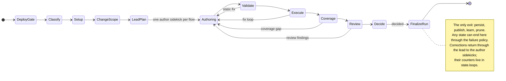
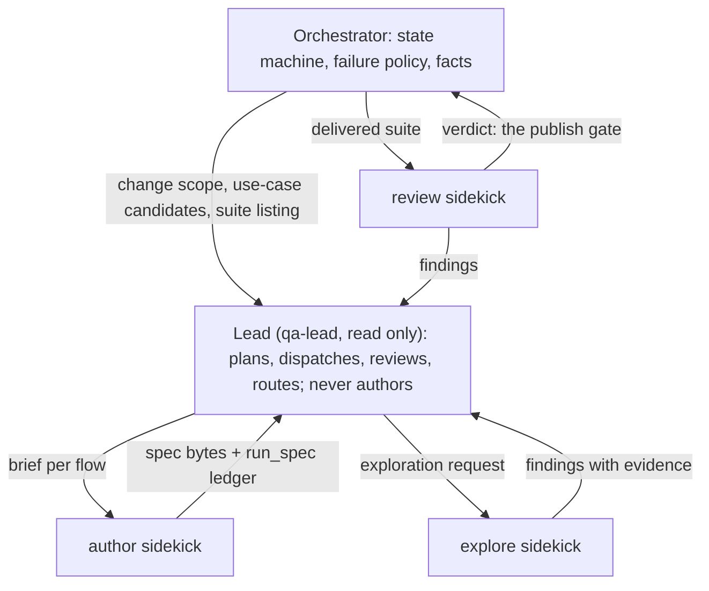

# Qayaba architecture review and remediation plan

Written 2026-10-25 for the owner. Phase documents (the specifications an implementing agent reads) are listed under [Implementation plan](#implementation-plan).

Qayaba is about halfway to the target. Layer purity is good and authoring is already lead-led. But the run is a linear step list with its failure policy scattered, context boundaries are unenforced, and the lead still authors alone on most small changes. Since the audit, the codegraph engine closed the graph's blind spots and change pages now reach the lead and the briefs, but the change-to-use-case chain still has no typed model and gates nothing, which is the core of the goal. The suite is red on 5 of 10,552 tests, all from the shared-model guard. The plan fixes this in eight phases, starting with a trustworthy baseline; the owner settled its seven decisions on 2026-10-25.

Scope: HEAD `b4a960fa` on `fix/failure-observation-conflict`, audited along six axes by independent read-only passes, with the key claims re-checked by hand; then re-checked at `2697c23c`, 44 commits later (Since the audit, below). Findings carry ids (H, M, L, C, D, N) or, for legacy remnants, a group name; the plan's Closes column refers to them.

## At a glance

| Axis | State today | Largest gap | Fixed in |
| --- | --- | --- | --- |
| Hexagonal layering | Domain and application are pure; 108 boundary violations, none enforced | One god-context; contexts import each other's infrastructure; engine/shell twins | P0.3, phase 3 |
| Run state machine | A linear list of 40 steps | No transitions; failure handling spread over about 35 hand-written catches; publication failure loses the decided verdict | phase 2 |
| Lead + sidekicks | Fan-out, lead review and correction routing exist | The lead authors alone on any plan under 2 flows; the reviewer runs outside the pattern, twice; no sidekick kinds | phase 4 |
| Change to use cases | Direct scope plus pages the call graph proves | No use-case model; the reach informs the lead but gates nothing; one commit per run | phases 5–6 |
| Legacy remnants | Removed modes are gone from code | `rewritten` and `legacy` names in about 110 files; 31 references to a missing `CLAUDE.md`; a duplicated prompt tree | phase 1 |
| Code quality | Tight typing; the engine reads no environment | 5 deterministic test failures; `history.ts`, `api.ts` and `index.ts` monoliths | P0.1, phase 7 |

## Since the audit

The review was re-checked at HEAD `2697c23c`, 44 commits after the audit. The main change is the code-graph engine: `codegraph` replaced codebase-memory-mcp, which closes C2 and most of C3, and the change pages the call graph proves now reach route ranking, the lead and the sidekick briefs. Per-run evaluation graders also landed. The run-flow, the agent pattern and the boundaries did not change; the plan stands with the edits named below.

The code graph now: `codegraph` 1.6.2 runs in the launcher's `graph` profile (sandbox uid, no network) over a tracked-files export of every repo the run reads, with a root-owned store cache. The orchestrator uses it for the structural signal, the change dossier, tier-2 cross-repo impact and change pages. The agent gets one read-only `codegraph_explore` action, for the lead only and over the trigger repo only.

Evaluation now: deterministic graders run after every run and only record (route coverage of plan and delivery, grounding of change pages, `run_spec` agreement, closed-loop refusals, sidekick reports). Hand labels against a use-case reference set are offline (`npm run label`). The use-case-coverage judge cannot run: `qa-judge` is not in the roster, and a judge must use a model other than the generator's.

Findings that moved:

| # | Now | Evidence at `2697c23c` |
| --- | --- | --- |
| C2 | Resolved. Seeds are every callable kind; the walk follows inbound calls, instantiations and route references. | `codegraph-store-reader.mjs:25,121` |
| C3 | Mostly resolved. Touched lines map to the innermost symbol; the inbound walk is ordered by depth and capped at 300 symbols with a truncated flag. No confidence per edge; a whole-file fallback remains when the diff was not read. | `codegraph-code-graph.adapter.ts:66-88` |
| C4 | Partly addressed. Pages the call graph proves join the change pages, ranked after map-linked pages and capped at 6. Page names still come from the LLM-authored context map. | `domain/change-pages.ts:128`, `route-ranking.ts:105` |
| C5 | Partly addressed. Tier 2 also matches a reached handler's route, and the cross-repo page proof walks callers of the front-end call site. The lead's tool still sees one repo. | `resolve-cross-repo-impact.use-case.ts:82-84`, `change-pages-port.adapter.ts:50-69` |
| C6 | Partly addressed. The lead is told which change pages its plan leaves unvisited or unproven, in authoring and in review. Nothing re-plans or rejects a plan (N1). | `lead-review.ts:95-120` |
| C7 | Partly addressed. Briefs carry proof lines (symbol and file names). No hunks, operations or per-candidate results. | `change-proofs.ts:17-21`, `sidekick-prompt.ts:82` |
| C9 | Partly addressed. A run whose scripts carried no source map now ends `unmeasured: no-source-maps`. Still not per candidate. | `objective-signal-port.adapter.ts:38` |
| C10 | Partly addressed. Graders, labels and a use-case judge exist; the judge cannot run and the labels are offline. | `graders.ts:316,407`, `judge-settings.ts:62` |
| L1 | Worse (N2). | `lead-plan.ts:189` |
| L5 | Partly addressed. Only the lead holds `codegraph_explore`; sidekicks get the graph's proofs in their brief instead. | `agents/opencode.json:65`, `code-graph-tools.ts:7` |
| H3 | Slightly worse (N6). |  |
| D1 | Improved. 5 of 10,552 fail, all from the shared-model guard; the load failures are gone. | `npm test` at `2697c23c` |

Re-checked and unchanged: M1–M10 (M4 at `publish.steps.ts:110`, M5 at `:42-45` and M6 still hold), L2–L4, L6, L7, C1, C8, H1 (`.dependency-cruiser.cjs` gained no layering rule) and D2.

New findings:

| # | Severity | Finding | Evidence |
| --- | --- | --- | --- |
| N1 | Medium | The change-page signals inform and nothing acts on them: the lead hears about unvisited and unproven pages and the graders record the gap, but no plan is admitted or rejected on it. | `lead-review.ts:99-120`, `graders.ts:316-332` |
| N2 | Medium | Lead-alone authoring carries more: a one-flow plan now passes its routes and the unvisited change pages to the lead's own authoring turn, one more path P4.1 and P4.5 must remove. | `lead-plan.ts:189`, `generate.steps.ts` |
| N3 | Medium | Two new run levers, the change dossier and the structural signal, are threaded through the contract, SDK, Go client, CLI, effective config and factory. Since `209dca5f` the dossier is on by default wherever the structural signal is; the levers remain. | `commands.ts:146-150`, `effective-config.ts:55-74` |
| N4 | Medium | The code graph is composed in the shell: `buildCodeGraph` picks the adapter, store-cache path, scope and launcher profile in `src/server`, and onboarding calls it directly. Composition kept growing: factory 1,676 lines, root 763, ports file 1,058. | `rewritten-engine-factory.ts:704-714`, `src/index.ts:604` |
| N5 | Medium | The `router` event kind gained one more emitter, which grows P1.3. | `lead-sidekicks.ts` (`reportUnvisited`) |
| N6 | Medium | Boundary drift no rule flags: the structural-signal adapter imports `generation/infrastructure/sanitize-text`, the change-pages domain imports `service-topology/domain`, and `scripts/label-run.ts` imports evaluation domain files by path. | `structural-signal-port.adapter.ts:12`, `change-pages.ts:19`, `label-run.ts:19-21` |
| N7 | Low | ADR-0002 still reads "Proposed — gated by the spike" although the spike passed and the migration landed. codebase-memory is gone from code, config, prompts and tests; 51 mentions remain in 10 docs, 16 of them in historical files P1.7 deletes. | `docs/adr/0002-code-graph-engine-codegraph.md:3` |
| N8 | Low | `joinChangePages` gathers coupled heuristics (source scoping, hubs, truncated seeds, suffix file matching); the next proof kind should be a strategy, not another branch. Hypothesis on trajectory. | `domain/change-pages.ts:68-179` |
| N9 | Low | Walk and join failures degrade to `console.warn` and no result; the new telemetry health reads its URLs from the environment directly (D10, D12); the store reader is an untyped `.mjs` outside the typechecked tree, covered by its own fixture test. | `change-pages-port.adapter.ts:61-85`, `backend-health.ts:61-63`, `codegraph-store-reader.mjs` |

## Hexagonal layering

Layer purity is good; boundaries are not, and `npm run arch:check` enforces none of them. A scratch dependency-cruiser config with hexagonal rules (not committed) reports 108 violations across 473 modules.

**What holds:** `domain/` has no `fs`, `child_process`, SDK or `process.env` use; `application/` imports `node:fs` in one file; `shared-kernel` imports no context; `qa-engine` never imports `src/`.

| # | Severity | Finding | Evidence |
| --- | --- | --- | --- |
| H1 | High | The 8 rules in `qa-engine/.dependency-cruiser.cjs` are all security or process rules. There is no domain-outward, application-to-infrastructure, cross-context or `no-circular` rule. Scratch rules find 53 cycles, 28 cross-context infrastructure imports, 18 application-to-infrastructure and 7 domain-to-application. Verified. | `.dependency-cruiser.cjs:44-117` |
| H2 | High | `qa-run-orchestration` is a god-context: 139 of about 340 context files and 19.2k of about 47k lines. It also holds coordination (28 files), the agent-tool registries, the grounding bridges, auth and login discovery. `RunQaUseCaseDeps` has 23+ fields and `CompositionConfig` about 90. | `application/coordination/`, `infrastructure/` |
| H3 | High | Contexts reach into each other's `infrastructure/`: 31 imports outside composition. 13 of the 42 `bridges/*` import `generation/infrastructure` (`context-pack`, `dom-snapshot`, `prompts`) or `test-execution/infrastructure` directly. `sanitize-text.ts` is imported by 5 contexts. No context has a public surface. | `bridges/pre-generation-grounding-port.adapter.ts`, `bridges/review-port.adapter.ts` |
| H4 | High | Engine and shell twins are kept in step by 10 `*-parity.test.ts` files: the error taxonomy, the sanitizer (316 vs 178 lines), verdict parsing, `src/types.ts` re-declaring kernel types, and `AgentRole` defined three times with different unions. | `src/qa/learning/taxonomy.ts`, `src/orchestrator/sanitizer.ts`, `src/types.ts` |
| H5 | High | `shared-kernel/contract/commands.ts` (1,118 lines of zod) is the shell's HTTP wire contract; the engine never imports it. 17 of 59 kernel modules have a single owning context. | `src/contract/commands.ts` re-export |
| H6 | Medium | `cross-run-learning` and `qa-run-orchestration` depend on each other (curriculum port, learning gates). 7 domain files import entity types from the application ports file. | `curriculum-port.adapter.ts`, `rule-fold.ts` |
| H7 | Medium | Application bypasses ports 15+ times, for example `spec-path-confinement` from steps and `exec-sandbox` from the use case. `service-topology/application` imports `node:fs` and git hardening. | `run-qa.use-case.ts:20-22`, `resolve-cross-repo-impact.use-case.ts:2-9` |
| H8 | Medium | Policy lives in the shell's composition: the learning fold's attribution, the publish pathspecs and commit message, the context-heal retry policy. | `rewritten-engine-factory.ts:246-280,405-455,561-585` |
| H9 | Medium | Two composition layers split by library rather than responsibility: an engine root of 743 lines, and a shell factory of 1,608 lines that also builds adapters. `pipeline-engine-flag.ts` always returns `"rewritten"` and warns about a `legacy` engine that no longer exists. Verified. | `composition-root.ts`, `pipeline-engine-flag.ts` |
| H10 | Medium | `application/ports/index.ts` (1,019 lines) holds 29 ports, about 47 data types and runtime constants. Six ports belong to other contexts. Git working-copy details leak through port types (`mirrorDir`, `isCode`, about 12 optional publish fields). | `ports/index.ts:659-717,759,1002` |
| H11 | Low | Dead or stray pieces: `contexts/agent-runtime` (a ports barrel only tests import), the `@interface/*` alias to a missing directory, `qa-engine/src/index.ts` (a comment only), two `spec-snapshot.port.ts`. `shared-infrastructure` mixes pure helpers with `fs` code. | `tsconfig.json`, `shared-infrastructure/` |

## Run state machine

The run-flow is a sequential step list, not a state machine: the next step is always the next array index, and the failure policy stayed behind in `run-qa.use-case.ts`.

**What exists today**

- `run-steps.ts:22-71` lists 2 pre-workspace and 38 in-workspace steps. Each step returns nothing, `{update}` or `{end}`.
- The runner (`run-flow.ts:26-41`) is a `for` loop: skip when the `runs` predicate is false, `Object.assign` the update, return on the first `end`. `step.name` is never read.
- The 15 `RUN_PHASES` are timing regions on a cursor (`run-phase-cursor.ts:20-36`), not states.
- `run-qa.use-case.ts` is still 1,435 lines: about 556 of types, 330 of terminal and degradation code (`terminalResult` alone is 155) and 170 of outcome mapping.

**Findings**

| # | Severity | Finding | Evidence |
| --- | --- | --- | --- |
| M1 | High | No explicit transitions. Branching lives in `runs` predicates over mutable state and in `{end}` returns that persist and publish inline. Nothing records why a step came next. | `run-steps.ts:52`, `run-qa.use-case.ts:882-917` |
| M2 | High | The real control flow is in imperative sub-loops inside single steps: static-fix `while`, pre-exec corrective regen, the fix loop (a 342-line step, 8 `break`s), coverage regen, review rounds (531-line file, 2 mid-loop exits), lead review and correction. | `execute.steps.ts:130`, `fix-loop.aggregate.ts:302-610`, `review.steps.ts:109,323` |
| M3 | High | No central error-to-degraded-outcome policy. Four mechanisms coexist: 3 mapped exception types, about 35 hand-written fail-open `catch` blocks, sentinel results and verdict folding through `ends.*`. Two rethrow rules (`rethrowIfRunDeadline`, `rethrowIfUntrusted`) depend on every catch remembering them. | `run-qa.use-case.ts:662-674`, `run-deadline.ts:39`, `domain-error.ts:58` |
| M4 | Medium | A publication failure ends through `ends.infraError`, which never persists. Its comment says the decided record is kept; the decided verdict is in fact discarded. Verified. | `publish.steps.ts:110`, `run-qa.use-case.ts:1174-1191` |
| M5 | Medium | `captureContextMap` swallows an untrusted-tree error that its adapter deliberately rethrows. Present since before the refactor. | `publish.steps.ts:42`, `context-map-capture-port.adapter.ts:39` |
| M6 | Medium | A spent deadline is swallowed during the coverage regen but ends the run as `E-TIME-BUDGET` in the static-fix, fix-loop and review regens. A proven green suite can be lost with no "keep what is proven" outcome. | `coverage.steps.ts:135` |
| M7 | Medium | decide → publish → persist → learn exists twice: in the step table and again inside `terminalResult`. | `run-qa.use-case.ts:1279-1434` |
| M8 | Medium | `RunState` is one bag of 11 sections and about 70 fields with sentinel defaults, not a per-phase union. `execution.run` has 5 writers. Live state also sits outside it (`ctx.generation.delivered` with 8 writers, `trail`, `proofLedger`, a `WeakMap` in the use case), so a run cannot be resumed from a state. | `run-state.ts:192`, `opening.steps.ts:62` |
| M9 | Low | Abort is 15 copies of `if (signal?.aborted) return …`, and there is no check between the fix loop and coverage. Three overlapping time controls: tier budgets, `RunDeadline`, `WallClockBudget`. | `phases/*.steps.ts` |
| M10 | Medium | Tests pin end verdicts and the happy-path order (2 sequence tests, 426 use-case tests through `run()`), not transitions. No test lists each end reason with its persisted, published and learned flags. | `run-phase-sequence.test.ts`, `run-qa.use-case.test.ts` |

The pieces that are already declarative and worth keeping: `decide()` (`run-decision.service.ts:36`), `terminalForGenerationEnd`, `terminalForPrecondition`, `decideProgress`, `learningGates` and `resolveErrorClass`.

## Lead + sidekicks

Authoring is already lead-led, but three things break the single pattern: the lead still authors alone on many paths, the reviewer is called by the orchestrator (and runs twice), and sidekicks have no typed kind, so there is no exploration or review sidekick.

**Role inventory**

| Role | Invoked by, in which phase | Tools | In the pattern |
| --- | --- | --- | --- |
| `qa-generator` as lead (plan, review, correction) | `GenerationPort.plan`, then `LeadSessionHandle.ask`, in generate and every correction | read only, `codegraph_explore`; browsers denied | yes |
| `qa-generator` as author | orchestrator: one-flow plans, fallbacks, takeover, leftover regenerations, code and context runs, Codex | write, `run_spec`, `authbrowser_*`, Playwright, Serena, `codegraph_explore` | no |
| `qa-sidekick` | `LeadSidekicks` via `SidekickExecutor`: fan-out, revise, replace | its own file, `run_spec`, `authbrowser_*` or Playwright, `set_geolocation` | yes |
| `qa-reviewer` | orchestrator in the review step, and again inline in `generate()` | read only | no |
| `qa-reflector`, `qa-assistant`, `qa-proposer`, `qa-maintainer`, `qa-judge` | learning, chat, onboarding, self-repair, evaluation | varies | platform roles, outside the run |

Exploration today is not an agent: it is the Context Pack, DOM capture, structural signal and change pages built by the orchestrator, plus the lead's `codegraph_explore` action.

| # | Severity | Finding | Evidence |
| --- | --- | --- | --- |
| L1 | High | Lead-alone authoring is a first-class path. The plan prompt offers `{"plan":{"kind":"lead"}}`, and any plan with fewer than 2 flows is downgraded to lead-alone (`ONE_FLOW`), which is the most common small-diff case. Six more doors end in the same `generate([])`: no plan, non-OpenCode planner, no sidekick grant, no coordinator wired, coordination threw, takeover. Lead and author are the same agent split only by a per-prompt tool denial, so every fallback silently regains write and browser tools. Verified. | `prompts.ts:81`, `lead-plan.ts:174`, `lead-sidekicks.ts:215-226,317-320`, `generate.steps.ts:42-70,117` |
| L2 | High | The reviewer runs in two places: the review step, and an inline session inside `GenerateTestsUseCase.generate` for every lead-authored generation. The inline verdict only feeds a fallback in `decide.steps.ts:21`; coordinated flows never get it. Lead-alone runs pay for a second reviewer session and get different outcome flags. Verified. | `generate-tests.use-case.ts:347-390`, `review.steps.ts:188` |
| L3 | Medium | No sidekick kind or registry. `qa-sidekick` is one role; the brief is hard-wired to "Write the Playwright E2E spec for ONE flow"; `AdmittedFlow` has no kind field. Specialization is implicit in the objective and routes. | `lead-sidekicks.ts:792-801`, `lead-plan.ts:45-60`, `agent-capability.ts:2` |
| L4 | Medium | The lead has no role prompt of its own. `qa-generator.md` still describes an author with modes; the plan, review and correction protocols exist only as runtime strings. When a plan is `lead` or downgraded, the planning session (up to 180 s) is thrown away and a fresh session re-explores. | `qa-generator.md:198`, `prompts.ts:77-95`, `lead-sidekicks.ts:289-290` |
| L5 | Medium | Exploration capability is split: the lead has the code graph but no DEV browser; sidekicks have DEV but no code graph, and Serena is always denied, contradicting the sidekick description in `opencode.json:406`. | `sidekick-authoring.ts:52` |
| L6 | Medium | Corrections funnel through one dispatch point (`regenerate` / `correctThroughLead`), but the reviewer path re-implements the branch, `LeadSidekicks.correct` has no per-pass cap, and there are two rebuttal sources (the lead's and the generator verdict's). | `generation-services.ts:158-212`, `review.steps.ts:326-335` |
| L7 | Low | Codex never coordinates, because the planner and the sidekick must both be OpenCode; `agent/roles/qa-sidekick.md` is therefore unreachable. `qa-judge` is missing from the `opencode.json` roster, so judge reports stay inert. `qa-reviewer.md` is still titled "Reviewer subagent" and speaks of "the generator's fix". | `lead-sidekicks.ts:217`, `sidekick-authoring.ts:39`, `judge-settings.ts:63` |

The `agents/` and `agent/` prompt mirrors are byte-identical apart from `qa-judge.md`. No `qa.explorer` config or code remains.

## Change analysis, use cases and delegation

This is the weakest link against the goal: indirect and cross-repo scope never reach pages deterministically, there is no typed use-case model, and a sidekick does not know which change its flow must exercise.

**The chain as it runs today**

1. Input: one push (`before..after`) for one repo. `webhook.ts:43`, `runner.ts:225`.
2. Classify: `git diff base sha`, Conventional Commit type cross-checked against the diff. `commit-classification.ts:35-48`.
3. Direct scope: files, lines, DOM labels and literals from `DiffParserService`; languages js, ts, java.
4. Indirect scope: the `codegraph` inbound closure from the touched symbols, a tier-2 cross-repo link and the change pages the call graph proves. The pages reach route ranking, the lead's review and the briefs; the rest is prompt text.
5. Pages: the LLM-authored `.qa/context.json` ranks routes by direct file match, with graph-proven pages after them (at most 6); the Context Pack captures 4 (8 per change). `route-ranking.ts:26-111`, `context-pack.ts:365-378`.
6. Plan: the lead emits free-text flows (objective up to 400 characters). Change pages no flow visits, or that no flow proves, are told to the lead and gate nothing. `lead-plan.ts:30`, `lead-review.ts:95-120`.
7. Delegation: the brief carries objective, acceptance, the flow's Live DOM and the call graph's proof lines. `lead-sidekicks.ts:427-450`.
8. Results: run\_spec, validate, execute, fix loop, change-coverage, reviewer, lead review, decide.

| # | Severity | Finding | Evidence |
| --- | --- | --- | --- |
| C1 | High | A cross-repo change is one commit in one repo. Service-repo dispatch drops `baseSha`; a feature landing in front and back becomes two serialized runs, each blind to the other's diff. The `commits` option is validated and queued but never reaches `RunInput`. | `webhook-routing.ts:30-37`, `commands.ts:163`, `runner.ts:225` |
| C2 | Resolved | Resolved since the audit: the code graph seeds every callable kind and walks inbound calls, instantiations and route references. At the audit, the traversal matched only `Method` to `Method` CALLS edges, which hid free functions and arrow components. | `codegraph-store-reader.mjs:25,121` |
| C3 | Medium | "Impacted" is a neighbourhood, not reverse reachability: anchored on whole files, unions callees with callers, `LIMIT 200` with no order, callers fetched for only the first 25 anchors. Direct scope never maps hunks to symbols; the `ChangedSymbol` extractor ports have no implementer. | `structural-signal-port.adapter.ts:12`, `change-analysis/application/ports/index.ts:30-34` |
| C4 | High | Indirect scope never reaches pages. A route is relevant only on a direct file match or a changed OpenAPI spec. A change in a shared service, util or backend makes no route relevant, and the capture falls back to the first 4 map routes. | `route-ranking.ts:26,99-105`, `context-pack.ts:375` |
| C5 | High | Cross-repo reach is one hop and contract-level. Any change to a service's OpenAPI file marks every link impacted; otherwise a link matches only when a symbol name equals the operationId. The front-end call site is never mapped to a route, and the lead's graph tools are bound to the trigger repo only. | `http-backend-resolver.adapter.ts:117`, `resolve-cross-repo-impact.use-case.ts:57-69`, `composition-root.ts:466` |
| C6 | High | No typed use-case model. Use-case choice is free text from the lead; the context map's `flows` and the manifest's `useCase` string are LLM-authored. Unvisited change pages do not trigger a re-plan. | `manifest-entry.ts:9`, `structural-pattern.ts` |
| C7 | High | A sidekick's brief has no changed files, lines, symbols or operations, and its workspace excludes `.git`. Its only link to the change is the lead's capped objective, so change-coverage cannot be aimed. | `delegation-workspace.adapter.ts:51` |
| C8 | High | Nothing ties a failure to the change. `app_defect` comes from a 5xx, an uncaught page error or a value mismatch with unique selectors, with no check that the page or request is in the change's reach. An unrelated 5xx reads as a regression. | `adjudicate.service.ts`, `authoring-failure.ts` |
| C9 | Medium | Change-coverage measures only front-end V8 coverage of added lines on green runs, defaults to `signal`, and is `unknown` for cross-repo, backend-only and deletion-only changes. | `coverage.steps.ts:37`, `run-config-gates.ts:13` |
| C10 | High | No measure of whether the delivered tests would catch a defect from the change: fault injection corrupts responses globally, the mutation oracle runs only for the code target, use-case coverage does not exist yet. | `odd/tasks/use-case-coverage-eval.md` (all tasks pending) |

Strengths to keep: the intent lock blocks weakening regenerations, reviewer findings must cite evidence, an app defect is never sent back to be made green, and run\_spec facts decide over a sidekick's own account.

## Legacy remnants

The removed `single` mode and explorer are cleanly gone from code, config, prompts and `AGENTS.md`; what remains is the vocabulary of the July cutover (`rewritten`, `legacy`, `bridges`), twins kept alive by parity tests, a duplicated prompt tree and about 30k lines of historical docs. Roughly 250 files need touching, most of them as renames.

| Group | What remains | Evidence | Files | Action |
| --- | --- | --- | --- | --- |
| Names | `rewritten` in 82 files (file names, `createRewrittenEngineFactory`, `RewrittenOrchestratorAdapter`, `runViaRewrittenEngine`); `pipeline-engine-flag.ts` always returns `"rewritten"` and warns about a `legacy` engine; `Legacy*` names for current types (`LegacyRunOutcome`, `roleForLegacyAgent`, 6 adapter deps); `bridges/` is the cutover plan's term for 42 files that are ordinary adapters plus pure helpers. | `src/server/rewritten-engine-factory.ts`, `pipeline-engine-flag.ts`, `run-history-sqlite-adapter.ts:5,24` | \~110 | Rename to the final concept; delete the flag, `PIPELINE_ENGINE` and its compose entry; `bridges/` becomes `adapters/` with helpers moved to `domain/`. |
| Removed-resource names | The coordination event kind `"router"` (named after the deleted router) is live in 10+ emitters, the OpenAPI contract, the SDK and the Go client. Escalation-ladder fossils (`DEFAULT_ESCALATION_POLICY` printed in every brief but never read), `generate(_objectives)` always `[]`, `PLANNER_*` env and constants, `worker`/`workerCode` in `AgentRoleSchema`. | `lead-sidekicks.ts:285-665`, `contract/openapi.json:1193`, `delegation-brief.ts:22-31`, `commands.ts:410` | \~25 | Rename `router` to a lead-decision kind and regenerate the contract; delete the fossils. |
| Dead references | `CLAUDE.md` no longer exists but 31 files reference it (verified), including a broken link in `README.md:494`. Two comments cite `reviewIndependently` at `opencode-client.ts:952-1009`; the function is gone and the file has 730 lines (verified). Docs cite `docs/code-mode-sandbox.md`, `docs/telemetry-attributes.md` and `shadow-run.operator.ts`, none of which exist; `tsconfig.json` excludes a missing test. | `generate-tests.use-case.ts:360`, `prompts.ts:1312`, `docs/execution-sandbox.md:10` | \~35 | Point every reference at what exists or delete it; add a CI check for dead file references. |
| Narrating comments | About 25 production and 60 test comments describe the process ("migration-tier-1-2, Slice 5", "previously", "the legacy loader", `LegacyPipelineAdapter`), plus 16 test titles carrying review ids. | `.dependency-cruiser.cjs:106,112`, `config/apps/example.yaml:41`, `run-qa.use-case.test.ts:1674-1767` | \~35 | Reword to the final state; rename tests by behavior. |
| Dead code | The whole `contexts/agent-runtime` context (a ports file only tests import), `catalog-gate.ts` and `selector-catalog-window.ts` (production uses `selector-check.ts`), `buildShadow`, `qa-engine/test/characterization/` (18 files no test loads), `clock.port.ts`, `run-step.ts`, 52 test-only exports in production folders. Check `rankRoutesByChange` before deleting: it may be a wiring gap. | `composition-root.ts:741`, `route-ranking.ts:109` | \~40 | Delete, with the tests that only test them. |
| Duplication | `agent/` is byte-identical to `agents/agent` except `qa-judge.md` (verified). Twins kept in step by 13 `*-parity` tests: sanitizer, error taxonomy, verdict parsing, `confidentWindowEnd`, Codex exec env, `ActivityKind` (3 declarations). | `scripts/agent-prompt-parity.test.ts`, `sanitize-text-parity.test.ts` | \~45 | One source per concept; generate or link the Codex mirror; delete parity tests with their twins. |
| Historical docs | `docs/superpowers/` (45 files, 29.5k lines of old plans), `docs/plans/` (points at deleted `src/pipeline.ts`), `docs/probe-reports/`, an ADR with 26 explorer lines and env vars that exist nowhere, `docs/traspaso-conocimiento.md` (Spanish, no lead or sidekicks). | `docs/adr/0001-grounding-telemetry-quality.md:243` | \~55 | Owner decision: delete, or move out of the repo. |
| Persisted-data shims | `RETIRED_EXPLORER_ROLE` for old rows, the legacy API-token path, the retired `"pending"` rule status, 16 ad-hoc `ALTER TABLE`s. | `history.ts:2361,577`, `api-token.ts` | \~10 | Owner decision: migrate the stored data once, then delete the shims. |

Verified clean: every npm script and every identifier `AGENTS.md` names exists; no `coordinationMode`, `--coordination`, `qa.explorer` or `orchestration-router` file remains. The `single`/`dual` provider mode in `AgentMode` is unrelated to the removed coordination mode, but its name invites the confusion.

## Code quality and technical debt

The suite is red on HEAD, and the worst debt sits in the shell (`src/`): persistence, the HTTP edge and the entry point. Type safety is tight; the engine reads no environment. Source is about 83k lines and tests about 144k (ratio 1.74).

| # | Severity | Debt | Evidence |
| --- | --- | --- | --- |
| D1 | Critical | `npm test` is red: 5 of 10,552 fail at `2697c23c` (16 of 10,029 in the audit run, 11 of them load failures that passed alone). All 5 fail deterministically because `agents/opencode.json` gives `qa-generator` and `qa-reviewer` the same model, which breaks the reviewer-independence guard; feature docs record them as "5 known failures". 20 test files read the real deployable config instead of fixtures. | `src/agent-runtime/config.test.ts`, `odd/tasks/lead-review-loop.md:34` |
| D2 | High | `src/server/history.ts` (2,487 lines) is a persistence monolith: 22 tables, 29 module-level prepared statements, a 513-line `ensureDb()` mixing DDL, 16 ad-hoc migrations and destructive retention `DELETE`s that run lazily on first access, outside any transaction, with no schema version. `safeJsonParse` hides corrupt columns. Analytics live here too. | `history.ts:185-697,1238,2330` |
| D3 | High | The API answers every app-config failure (YAML error, unset `${VAR}`, schema error) with 404 "app not found". Verified. | `api.ts:502,944,957,972,1046,1073,1128,1610`, `src/index.ts:690` |
| D4 | High | `prompts.ts` (1,609 lines): `buildPromptAssembled` is 508 lines of ternaries over mode, target and turn with prose inline. Tests are wording-coupled: 86 `assert.match` on prompt text in one file. | `prompts.ts:316-823`, `prompts.test.ts` |
| D5 | High | `src/index.ts` (1,017 lines) has 33 env reads, listens on import, and holds the inline router, auth gate, rate limiter and signal handlers; no test imports it. `buildRewrittenCompositionConfig` is one 789-line function. | `rewritten-engine-factory.ts:756` |
| D6 | Medium | `src/server/api.ts` (1,729 lines): a 221-line regex router, continuation rules inside a handler, 10 copies of body parsing, 17 hand-rolled checks against 13 zod parses, and two error shapes. | `api.ts:1463,1370` |
| D7 | Medium | God functions: `reviewTests` 420 lines (cognitive 103), `createOnboardingJob` 421, `createMaintainerRuntime` 517, `buildContextPack` 270 (cognitive 148), `enqueueTrackedRun` 286, `runFixLoop` 254, `terminalResult` 155. | `review.steps.ts:42`, `context-pack.ts:351`, `runner.ts:336` |
| D8 | Medium | Positional-parameter explosion: `enqueue` takes 13 positional parameters and callers pass literal `undefined`. | `api.ts:114,598`, `src/index.ts:378` |
| D9 | Medium | Duplication: twin sanitizers, byte-identical helpers (`capText`, `clampTitle`, `extractJsonObjects`), `escapeRegExp` 4 times, five near-identical capability closers, 232 inline error-message extractions. | `run-qa.use-case.ts:746-808` |
| D10 | Medium | No logging abstraction: 396 `console.*` calls in production code (250 in the engine) with free-form strings; 33 `redactError` calls against 232 raw error-message sites. | `console-log-tap.ts` |
| D11 | Medium | `scripts/mutate.ts` pins 99 `file:start-end` line ranges and was touched by 83 of the last 150 commits. Its guard checks only that a range fits in the file, so drift silently mutates the wrong code. | `mutate.test.ts:49` |
| D12 | Medium | Configuration sprawl: 67 env names in 36 shell files, 17 separate `resolveX(env)` functions, 8 per-app booleans and 4 off/signal/enforce enums. | `src/orchestrator/schemas.ts:220-330` |
| D13 | Medium | Infrastructure files mix pure logic with untyped embedded scripts: a 279-line Playwright script as a template string in `dom-snapshot.ts`, a fixture with 14 `catch {}` in `setup.adapter.ts`. | `dom-snapshot.ts` (`buildCaptureScript`) |
| D14 | Low | Test shape: `run-qa.use-case.test.ts` is 9,450 lines with 426 tests; 23 test files exceed 1,000 lines. |  |

Checked and not a problem: `as any` 7, `: any` 11, `@ts-ignore` 0, `eslint-disable` 6; most empty catches carry a rationale. The graph under-reports complexity for ternary-heavy functions, so the sizes above come from line spans and hand counts.

## Target architecture

One deterministic orchestrator drives a declared state machine. It computes the change's scope and use-case candidates, and hands them to one lead and three kinds of sidekick. Every context reaches another only through its public ports.

### Contexts

| Context | Owns | Depends on |
| --- | --- | --- |
| run-orchestration | The run state machine, the failure policy, `finalizeRun` | Every other context's public API |
| change-analysis | `ChangeSet`, `ChangeScope`, `UseCaseCandidate`, the language registry | Kernel; code-graph port |
| service-topology | Cross-repo links, per-operation OpenAPI diff | change-analysis |
| coordination | Plan admission, the sidekick-kind registry, dispatch, lead review and correction | generation, agent-tools |
| generation | Prompt section registry, Context Pack, agent turns | Kernel agent-runtime port |
| agent-tools | `run_spec`, authenticated browser, code-graph tools, geolocation, each bound to sessions | test-execution |
| test-execution | Sandboxed Playwright and code-suite runs | Kernel |
| objective-signal | Change-coverage, causal label, change-targeted fault injection | change-analysis |
| cross-run-learning | Error taxonomy, rule fold and governance, curriculum | Kernel |
| workspace-and-publication | Working-copy handle, suite store, publish policy | Kernel |
| app-catalog | App configuration, auth and login discovery | Kernel |
| evaluation | Graders and judges over run records | Run records, read only |

Rules, enforced by dependency-cruiser: `domain/` imports nothing outward; `application/` depends on ports, one file per port; a context imports another only through its `application/index.ts`; no cycles. The shell (`src/`) keeps one composition root, the control plane, the wire contract and persistence adapters, and imports the engine's canonical types instead of copying them.

### Run state machine

Each step declares an id, a phase, a guard and a failure class, and returns `next`, `goto(state)` or `end(RunEnd)`. Sub-loops are states whose counters live in `state.loops`. `finalizeRun` is the only place that persists, publishes and learns.

Every correction re-enters authoring through the lead, and every end, decided or failed, goes through `finalizeRun`.

| Failure | Response | Changes today's behavior |
| --- | --- | --- |
| Run deadline, suite already proven green | Degrade: keep what ran green on its final bytes, with a note | Yes (M6) |
| Run deadline, nothing proven | End `infra-error E-TIME-BUDGET`; persist evidence; learn nothing | No |
| Sandbox unavailable | End `infra-error E-SANDBOX` | No |
| Untrusted git tree | Always rethrow as a security refusal | Yes (M5) |
| Reviewer unavailable | End `infra-error E-REVIEWER-UNAVAILABLE`; persist | No |
| Publication failed after a decision | End with the decided verdict persisted and a note | Yes (M4) |
| No decision, step budget, no sidekick can author | End `infra-error` with its code and reason | Yes for the last case (P4.5) |
| Off-path step (context-map capture, telemetry, suite store) | Fail open, log, verdict unchanged | No |
| Aborted | End `aborted`, not persisted | No |
| Unknown error | Rethrow; the shell records `internal-error` | No |

### Agent topology

- **Lead** (`qa-lead`, read only): receives the change scope, the use-case candidates and the suite listing; plans flows, asks for exploration, dispatches authors, reviews their results (accept, revise, replace, drop) and routes the reviewer's findings. It never authors.
- **author** sidekick: writes, runs and fixes one flow's spec with `run_spec` and the authenticated browser. Its brief names the candidates, hunks, symbols and the source of the expected behavior.
- **explore** sidekick: read only, with the code graph and the authenticated browser; returns findings with evidence the orchestrator checks.
- **review** sidekick: an independent session that judges the delivered suite; the orchestrator owns its verdict as the publish gate, and its findings go to the lead.
- Outside the run: the reflector, assistant, proposer, maintainer and judge stay platform roles.

The orchestrator's facts (the run\_spec ledger, change-coverage, the causal label) decide over the lead's and the sidekicks' own accounts.

## Implementation plan

Eight phases. Phase 0 makes the suite and the boundaries trustworthy; 1–4 fix the architecture without changing behavior except in named commits; 5–6 build the change-to-use-case chain that the goal is about; 7 is independent shell work that can run beside 2–6. Each phase becomes one ODD feature document with work-unit commits on the current branch; a task whose Risk names a high-risk item ships as its own commit with an independent verifier.

Phase documents, one ODD feature document per phase; each is the full specification an implementing agent reads, task by task:

| Phase | Document |
| --- | --- |
| 0 — Trustworthy baseline | [`odd/tasks/arch-p0-trustworthy-baseline.md`](../odd/tasks/arch-p0-trustworthy-baseline.md) |
| 1 — Remove previous forms | [`odd/tasks/arch-p1-remove-previous-forms.md`](../odd/tasks/arch-p1-remove-previous-forms.md) |
| 2 — Run state machine | [`odd/tasks/arch-p2-run-state-machine.md`](../odd/tasks/arch-p2-run-state-machine.md) |
| 3 — Hexagonal re-cut | [`odd/tasks/arch-p3-hexagonal-recut.md`](../odd/tasks/arch-p3-hexagonal-recut.md) |
| 4 — One agent pattern | [`odd/tasks/arch-p4-one-agent-pattern.md`](../odd/tasks/arch-p4-one-agent-pattern.md) |
| 5 — Change scope, use cases, delegation | [`odd/tasks/arch-p5-change-scope-use-cases.md`](../odd/tasks/arch-p5-change-scope-use-cases.md) |
| 6 — Result quality | [`odd/tasks/arch-p6-result-quality.md`](../odd/tasks/arch-p6-result-quality.md) |
| 7 — Shell debt | [`odd/tasks/arch-p7-shell-debt.md`](../odd/tasks/arch-p7-shell-debt.md) |

### Corrections and owner decisions from the phase documents

The phase documents re-checked the plan against the code (HEAD `209dca5f`; phase 2 at `17a24923`, phase 7 at `8fe66dcf`). These are the places where HEAD differs from what the review said; the phase document named in the last column carries the correction.

| Plan id | The review said | HEAD shows | Carried by |
| --- | --- | --- | --- |
| P0.1 | 20 tests read `agents/opencode.json` | 14 test files name it; an fs-preload census (P0 S1b step 1) gives the authoritative list | P0 S1b |
| P0.3 | 108 violations (more since, N6) | 181 with the four committed rules (53 cycles, 102 cross-context, 18, 8); phase 3's scratch variant measured 189 and 110; P0.3's rules, baseline file and ceiling are authoritative and each phase re-measures | P0 S3, P3 "How to measure" |
| P1.1 | `rewritten` in 82 files | 88 files | P1 S1b |
| P1.4 | `run-step.ts` is dead | live (`ground.steps.ts`, `coarse-run-efficiency.ts`, `ports/index.ts`, `scripts/probe-metrics.ts`); keep it | P1 S4a item 11 |
| P1.4 | Wire or delete `rankRoutesByChange` | a thin wrapper over `rankRoutesWithRelevance`, which production already calls; delete the wrapper | P1 S4a item 10, P5 S4 |
| P1.4 | `qa-engine/test/characterization/` holds 18 files no test loads | 3 tests there run under `npm test`; `equivalence.ts` is imported by `run-outcome.test.ts` (move it, delete the rest) | P1 S4a item 3 |
| P1.4 | 52 test-only exports | 44 by the rule P1 S4b gives; 12 of them die with S4a or S5 | P1 S4b |
| P1.6 | 31 `CLAUDE.md` references, about 35 narrating comments, 16 test titles with review ids | 30 files and 53 lines (`AGENTS.md:222` is legitimate), 44 narrating lines; the 16-title class does not reproduce, titles that name a previous form are the set to rename | P1 S6a |
| P2 | 40 steps, about 35 fail-open catches, 8 `break`s in the fix loop | 45 table entries (2 + 43), 76 `catch` blocks (about 35 is the subset that continues the run), 11 `break;` lines | P2 map, S4a, S6d |
| P3.3 | ports file of 1,019 lines, 29 ports, 47 types | 1,058 lines, 30 ports, 76 types | P3 S3 |
| P4.1, P4.5 | Six doors into lead-alone authoring | more than 20 call sites in 10 groups (time check, seven plan rejections, regenerations, code, context and login-seed runs) | P4 S5a |
| P5.4 | Existing specs "from TESTS edges" | the code graph has no such edge (`calls`, `contains`, `imports`, `instantiates`, `references`); the manifest `targets` and a suite text match replace it | P5 S4 |
| P5.7, N3 | The dossier stays off until the T9 measurement | on by default since `209dca5f`; only the levers remain to delete | P5 S7 |
| P6.3 | Fault injection aimed at the reach | no global fallback: without a scope an app gets no fault-injection score (a deliberate deviation) | P6 S3 |
| P6.4 | Finish `use-case-coverage-eval` | split into a deterministic `candidate_recall` grader (unblocked) and a judge that reads candidates (live use blocked by P4.6) | P6 S4 |
| P7.2 | 67 settings | 117 `process.env` reads in 27 files and about 90 candidate names; the registry settles the count | P7 S2a |
| P7.4 | 86 `assert.match`, 1,609 lines in `prompts.ts` | 155 matches across 20 test files, 1,623 lines | P7 S4b |

Owner questions from the phase documents. On 2026-10-25 the owner accepted every recommended answer ("Acepto las recomendaciones"), so each answer below is decided and recorded in the last Log entry of its document:

- **P0, mutation anchors.** Marker comments in 18 protected production files (S2)? Decided: yes, comment-only and token-identical, shipped alone with a verifier.
- **P0, shared docs.** May phase 0 edit one sentence each in `AGENTS.md` and `docs/testing-standards.md` while another session edits `AGENTS.md`? Decided: yes, after re-reading.
- **P1, `docs/traspaso-conocimiento.md`.** Delete this Spanish handover document, which predates lead and sidekicks and is not in the approved list? Decided: delete it in T11.
- **P1, ADR-0001.** Delete it although live docs cite its sections? Decided: delete as approved and repair each citation.
- **P1, Go client flags.** Remove `--opencode`, `--codex`, `--dual` and `agent set`? Decided: remove all four and keep `qayaba agent status|models opencode`.
- **P2, deadline with a required review but no verdict (S5c).** Treat it as "nothing proven" and keep `E-TIME-BUDGET`? Decided: yes, it keeps "green + approved + coverage not blocking -> PR".
- **P3, two readings (S9, S1).** Bind the shell (`src/`, `scripts/`) to the public surfaces too, and keep `change-pages.ts` in `service-topology`? Decided: yes to both; no answer needed unless the owner disagrees.
- **P4, P4.6 (`qa-judge`).** Add it to the roster or delete the staged block? Decided: keep it staged until a second model exists, because `judge-settings.ts` refuses a judge on the author's model and the roster has one provider and one model; T9 stays `blocked: owner decision`.
- **P5, re-plan bound (S5).** One re-plan, then admit and record `unplanned`? Decided: keep.
- **P5, coalescing scope (S1b).** Only `e2e` webhook runs of one app? Decided: keep; widen only with evidence.
- **P5, invariant wording (S3c).** The code-graph bullet of `AGENTS.md` must read "each repository of the run's change". Decided: the other session applies the text from the commit message.
- **P6, apps without a scope.** Accept that an app with `structuralSignals.mode: off` gets no fault-injection score? Decided: accept. Superseded by P5 L25: the key is gone and every app has the structural signal, so a run without a scope is one whose change the graph could not resolve.
- **P6, enforce.** Which apps move to `qa.coveragePolicy.mode: enforce`? Decided: none until a local-frontend run with source maps measures coverage in 3 replicates and the S3 calibration passes on the same case.
- **P6, P4.6.** Same question as P4; the recommended answer is the same.
- **P6, out-of-reach label.** Should it change what the harness does? Decided: not in this phase; record first.
- **P7, existing `qayaba.db` that does not match schema 1 (S1a).** Refuse to start and ask the operator to move it aside, or delete it automatically? Decided: refuse, because run history and the learning ledger are the only non-regenerable data.

The phase documents supersede the one-line plan tables below wherever they differ.

Conventions the eight documents share:

- **Names.** Later documents use the names earlier phases create: P1 `run-engine-factory.ts` (`createRunEngineFactory`, `buildCompositionConfig`), `run-pipeline.adapter.ts` (`RunPipelineAdapter`), `StoredRunOutcome`, `roleForAgentName`, `adapters/` and `wireAdapters`, event kind `lead-decision`; P2 `EndReason`, `RunEnd`, `finalizeRun`, `FailureKind`, `StepClass`, `guarded`, `state.loops`, with P0.4's rows as `RUN_END_ROWS` (S1 of P2 maps each row to its `EndReason`); P3 contexts `run-orchestration`, `coordination`, `agent-tools`, root `src/server/engine-root.ts`, `codeGraphFor`; P4 `qa-lead`, `qa-author`, `qa-explore`, `qa-reviewer`, `E-NO-AUTHOR`, `LeadPort`. A HEAD `path:line` in a document is a locator; the symbol is the reference and T0 re-resolves it.
- **Shared documents.** `AGENTS.md` and `docs/agent-reference.md` carry another session's uncommitted edits: while they do, no phase edits them (it records the replacement text in its Log); once they are committed and clean, the phase that owns a line edits it (P1.5, P4 and P5 S3c name the lines).
- **Prompt registry.** P7.4 (`prompts.ts` as a section registry) lands before P4.1 when scheduling allows; otherwise P4 edits the functions it names and P7.4 registers them unchanged.
- **Banned words.** Files, tests and comments written by any phase obey the banned-term rules of the P1.6 check (`legacy`, `parity`, `characterization`, `bridges`, `rewritten`, `router`, ...).

### Phase 0 — Trustworthy baseline

Gate: `npm test` 0 failures; `arch:check` green against a frozen baseline.

| ID | Task | Closes | Risk |
| --- | --- | --- | --- |
| P0.1 | Make the 20 tests that read `agents/opencode.json` use fixtures; turn the reviewer-independence rule into a startup warning recorded on the run (both roles share a model for now). | D1 | 5 |
| P0.2 | Anchor `scripts/mutate.ts` ranges to symbol names or marker comments instead of line numbers, before phases 2–3 move every line. | D11 | none |
| P0.3 | Add hexagonal rules to dependency-cruiser (domain outward, application to infrastructure, cross-context internals, `no-circular`) with the violations counted when the phase starts (108 at the audit, more since: N6) frozen as a baseline that can only shrink. | H1 | 5 |
| P0.4 | One characterization test per end reason: verdict, furthest phase, persisted, published, learned. Pins today's behavior before the machine changes. | M10 | none |
| P0.5 | Typed `AppNotFound` and `AppConfigInvalid` errors and one `withApp()` guard in the API. | D3 | 3 |

### Phase 1 — Remove previous forms (behavior-neutral)

Gate: a CI check over a banned-terms list and dead file references returns only allowed hits.

| ID | Task | Closes | Risk |
| --- | --- | --- | --- |
| P1.1 | Delete `pipeline-engine-flag.ts` and `PIPELINE_ENGINE`; rename every `rewritten*` and `Legacy*` file and symbol to its final concept. | Names | 5 (compose env) |
| P1.2 | `bridges/` becomes `adapters/`; pure helpers move to `domain/`; update the prefixes in `merge-guard.ts` and `mutate.ts`. | Names | 2 (merge guard) |
| P1.3 | Rename the `router` coordination event kind (one more emitter since the audit, N5); regenerate OpenAPI, SDK and Go client. | Removed-resource names | 3 |
| P1.4 | Delete dead code and fossils: `contexts/agent-runtime`, `catalog-gate`, `characterization/`, `buildShadow`, the escalation policy, `_objectives`, `PLANNER_*`, `worker`/`workerCode`. Wire or delete `rankRoutesByChange`. | Dead code | 3 (role enum) |
| P1.5 | Remove Codex and dual mode: `codex-strategy.ts`, the `agent/` prompt tree, the Codex install and exec env, `withCodexRolePreamble`, the `single`/`dual` role mode, and their parity tests. Keep the agent-runtime port and the role-to-provider interfaces for future runtimes. | Duplication | 3 |
| P1.6 | Fix the 31 `CLAUDE.md` references, the dead file references and about 35 narrating comments; set ADR-0002 to its decided status (N7); add the CI check. | Dead references, comments | none |
| P1.7 | Delete the historical docs and the persisted-data shims with no migration; purge old rows only where removing a shim would leave them unreadable. | Historical docs, shims | 1 (shims) |

### Phase 2 — Run state machine

Gate: one transition test per sub-loop; the P0.4 table unchanged except the rows a P2.5 commit names.

| ID | Task | Closes | Risk |
| --- | --- | --- | --- |
| P2.1 | Step ids, an `EndReason` on every end, and one `qayaba.step` event per transition and skip. Telemetry only. | M1 | none |
| P2.2 | A closed step outcome (`next`, `goto`, `end: RunEnd`) and one `finalizeRun(end)` as the only place that persists, publishes, learns and prunes; delete `terminalResult` and the `ends.*` builders. | M7 | 1 |
| P2.3 | Abort as a runner transition checked between every step; delete the 15 copies. | M9 | none |
| P2.4 | Failure policy table: `classifyFailure(err)` to a `FailureKind`, `policy[kind][stepClass]` to rethrow, fail open, end or degrade, applied by one `guarded()` wrapper. Migrate one phase at a time. | M3 | 6 |
| P2.5 | Behavior fixes, one commit each: a publication failure persists the decided outcome (M4); an untrusted tree is always rethrown (M5); the deadline after a proven suite (M6: degrade, keep what is proven). | M4–M6 | 2 (M5) |
| P2.6 | Sub-loops as states with counters in `state.loops`: fix loop (`FixLoop` becomes a pure `nextAction`), review rounds, static fix, coverage regeneration, lead review and correction with a per-pass budget. | M2, L6 | 6 |
| P2.7 | Typed per-phase state with one writer per field, live handles only in the context, one time authority (the run deadline; tier budgets derived from it). Checkpoint becomes state + workspace digest + step id. | M8 | 4 |

### Phase 3 — Hexagonal re-cut

Gate: the P0.3 baseline reaches zero; no cycles.

| ID | Task | Closes | Risk |
| --- | --- | --- | --- |
| P3.1 | Split `qa-run-orchestration` into run-orchestration (the flow only), coordination and agent-tools; auth and login move to app-catalog; grounding adapters move to generation. | H2 | none |
| P3.2 | A public surface per context (`application/index.ts`), enforced by a rule; adapters depend on public APIs only. | H3 | none |
| P3.3 | One file per port; entity types into `domain/`; a workspace handle hides `mirrorDir`, `sha` and `isCode`. | H6, H10 | none |
| P3.4 | Kernel diet: the wire contract moves to `src/contract`, single-owner modules into their context, the sanitizer behind the redaction port; curriculum and learning gates into cross-run-learning to break the cycle. | H5, H6 | 2 (redaction) |
| P3.5 | Collapse every engine/shell twin to the engine copy (taxonomy, sanitizer, verdict parsing, `src/types.ts`, `AgentRole`); delete the parity tests. | H4, D9 | 2 |
| P3.6 | `build<Context>(deps)` per context and one root in the shell; the learning fold and the publish policy move out of the factory into their use cases, and `buildCodeGraph` moves out of the shell into the code graph's builder (N4). | H7–H9 | none |

### Phase 4 — One agent pattern

Gate: one authoring path in code: no `generate()` call outside the author sidekick.

| ID | Task | Closes | Risk |
| --- | --- | --- | --- |
| P4.1 | A `qa-lead` role and prompt: read-only; plans, dispatches, reviews, routes; never authors. Remove plan kind `lead` and `ONE_FLOW`: one flow is one sidekick. | L1, L4 | 3 |
| P4.2 | A `SidekickKind` registry (id, prompt, tool allow-list, brief template, result schema, budget, model tier) with kinds `author` (e2e and code targets), `explore` and `review`. | L3 | none |
| P4.3 | The reviewer becomes the `review` kind; the publish gate stays the orchestrator's and the lead cannot skip or edit its verdict; delete the inline reviewer. | L2 | 6 |
| P4.4 | The `explore` kind: code graph and authenticated browser, read-only, findings carry evidence the orchestrator checks against the Context Pack and the graph. | L5 | 2 |
| P4.5 | Every door that lands in lead-alone authoring today, including the one-flow path that now carries change pages to the lead's own turn (N2), becomes a recorded failure-policy outcome instead. | L1 | 6 |
| P4.6 | Decided: keep `qa-judge` staged in `agents/pending/` until a second model is available; enabling it then is its own governance commit. | L7 | 5 |

### Phase 5 — Change scope, use cases, delegation

Gate: the use-case-coverage grader reports plan and delivery coverage per candidate.

| ID | Task | Closes | Risk |
| --- | --- | --- | --- |
| P5.1 | A `ChangeSet` built at enqueue: repos × (base, head, commits), coalescing queued runs of one app; service dispatch keeps its base; `commits` honored. | C1 | 3 (API) |
| P5.2 | Graph correctness. Done in the codegraph migration: callable-kind seeds, touched lines mapped to symbols, an inbound closure ordered by depth. Left: a confidence per edge and a free-function fixture. | C2, C3 | 6 |
| P5.3 | A `ChangeScope` whose reach set ends at entry points (routes, operations), with a tier and an evidence path per entry; cross-repo hops by per-operation OpenAPI diff and callers of the front-end call site; the lead's graph tools over every repo of the change. | C5 | none |
| P5.4 | Deterministic `UseCaseCandidate[]` (entry, tier, evidence, reachability, existing specs from TESTS edges and the manifest) feeding route ranking and the Context Pack; the context map becomes a cache. | C4, C6 | none |
| P5.5 | Plan admission: every direct-tier candidate is covered or dropped with a reason, otherwise the lead re-plans. It turns today's unvisited and unproven change-page signal (N1) into a gate. | C6 | none |
| P5.6 | Briefs carry candidate ids, hunk excerpts, symbols and the source of the expected behavior, beside today's proof lines; results come back per candidate. | C7 | none |
| P5.7 | After the T9 measurement, delete the dossier and structural-signal run levers (the dossier default is already on since `209dca5f`). | N3 | 3 (CLI and contract) |

### Phase 6 — Result quality

Gate: an Issue states whether its failure is in the change's reach.

| ID | Task | Closes | Risk |
| --- | --- | --- | --- |
| P6.1 | A causal label on every adjudication and Issue: in or out of the change's reach. | C8 | none |
| P6.2 | Change-coverage per candidate, with the reason when it is unknown (backend, deletion-only, cross-repo). | C9 | none |
| P6.3 | Fault injection aimed at the operations in reach; calibrate, then move to enforce. | C10 | none |
| P6.4 | Finish `use-case-coverage-eval` on top of the candidates. | C10 | none |

### Phase 7 — Shell debt (runs beside 2–6)

Gate: no persistence write outside a transaction; one settings object.

| ID | Task | Closes | Risk |
| --- | --- | --- | --- |
| P7.1 | `history.ts`: versioned, transactional migrations; one repository per aggregate; retention as an explicit prune job, never on read. | D2 | 1 |
| P7.2 | `createApp(deps)` and a thin `main()`; one typed `Settings` with generated docs. | D5, D12 | 5 |
| P7.3 | `api.ts`: a route table, zod request schemas, use-case functions, one error shape, a `RunRequest` object instead of 13 positional parameters. | D6, D8 | 3 |
| P7.4 | `prompts.ts` as a section registry (`applies`, `render`); tests assert claims and section ids, not wording. | D4 | none |
| P7.5 | A `LoggerPort` that redacts; embedded browser scripts as typed, linted files. | D10, D13 | 2 |

## Risks and decisions for the owner

The owner settled all seven decisions on 2026-10-25; the plan below already reflects them.

- [x] **Reviewer model (P0.1).** Both roles keep the same model for now; it changes later as configuration only. Tests read a fixture instead of `agents/opencode.json`, and the independence rule becomes a startup warning recorded on the run instead of a failing test.
- [x] **Historical docs (P1.7).** Delete `docs/superpowers/`, `docs/plans/`, `docs/probe-reports/` and the stale ADR; git history keeps them. `odd/tasks/` logbooks stay while their feature is open.
- [x] **Persisted-data shims (P1.7).** Delete them with no migration: `RETIRED_EXPLORER_ROLE`, the legacy token path, the retired `pending` rule status. Where an old row could no longer be read, purge those rows instead; viability is checked shim by shim.
- [x] **Deadline after a proven suite (P2.5, M6).** Degrade: keep and publish what ran green on its final bytes, with a note. With nothing proven, `infra-error E-TIME-BUDGET` stays.
- [x] **No sidekick can author (P4.5).** `infra-error` with a named reason, never a silent lead-alone run.
- [x] **Codex and dual mode (P1.5).** Remove Codex and every piece of dual-mode logic; OpenCode is the only runtime. Keep the provider-agnostic agent-runtime port and the role-to-provider interfaces, even if minimal, so other agents can be added later.
- [x] **Order.** Architecture first: phases 0 to 6 in order, phase 7 alongside.

Risks:

| Risk | Effect | Mitigation |
| --- | --- | --- |
| Another session commits to this branch while the plan runs (HEAD moved from `bd6413ef` to `b4a960fa` during the review, then 44 commits more by `2697c23c`). | Conflicts in `lead-sidekicks.ts`, `history.ts`, `composition-root.ts`. | One owner per phase; park `use-case-coverage-eval` before phase 4: it still edits `lead-sidekicks.ts`, `lead-plan.ts` and `lead-review.ts`. |
| Phase 3 moves about 140 files. | Long-lived conflicts; review fatigue. | Moves and renames in pure commits with no logic change; P0.2 anchors keep the mutation gate valid. |
| Contract renames (P1.3, P5.1, P7.3). | The TUI, SDK and web console break. | Regenerate the contract, SDK and Go types in the same commit; `contract:check` gates it. |
| P2.4 and P2.6 change control flow in the run's core. | A silent verdict change. | P0.4 pins every end reason first; each behavior change is its own commit naming the rows it changes. |
| The graph depends on `codegraph` 1.6.2 and a store reader tied to its schema. | Wrong reach sets. | The store is validated before use and the reader is tested against recorded fixtures; moving the pin re-records both. Reach entries still need a confidence (P5.2); the scope stays declared in the language registry. |
